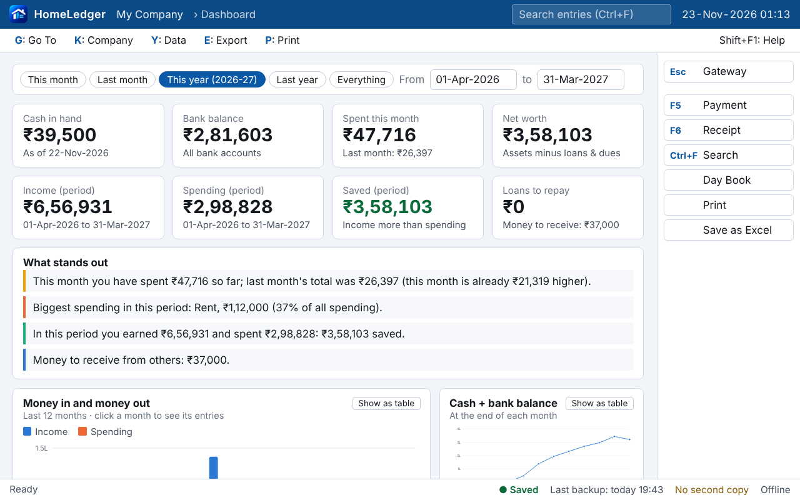
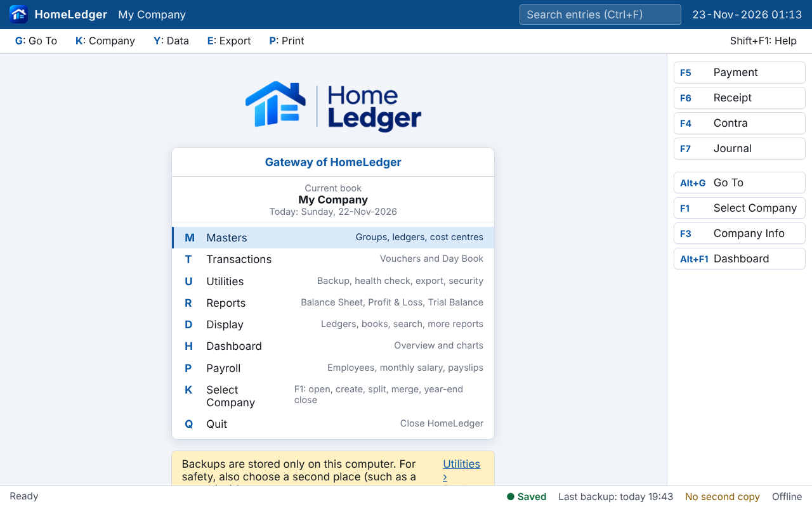
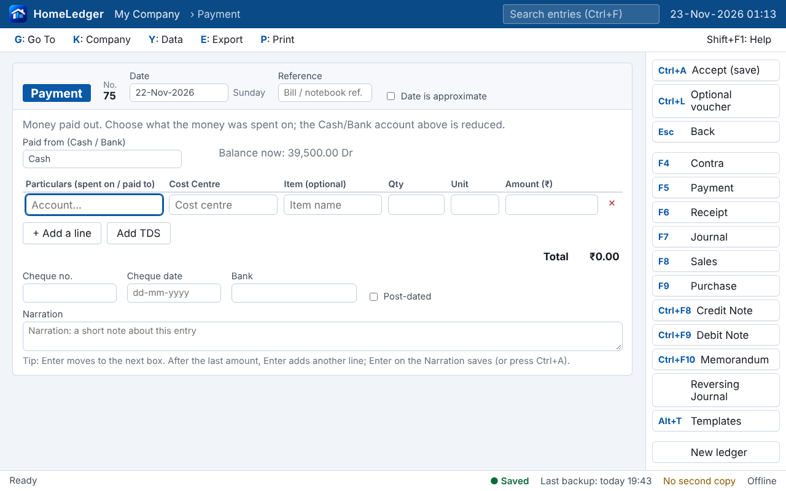
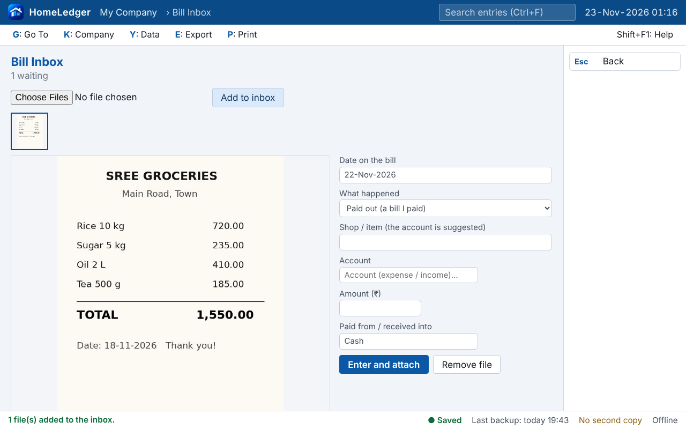
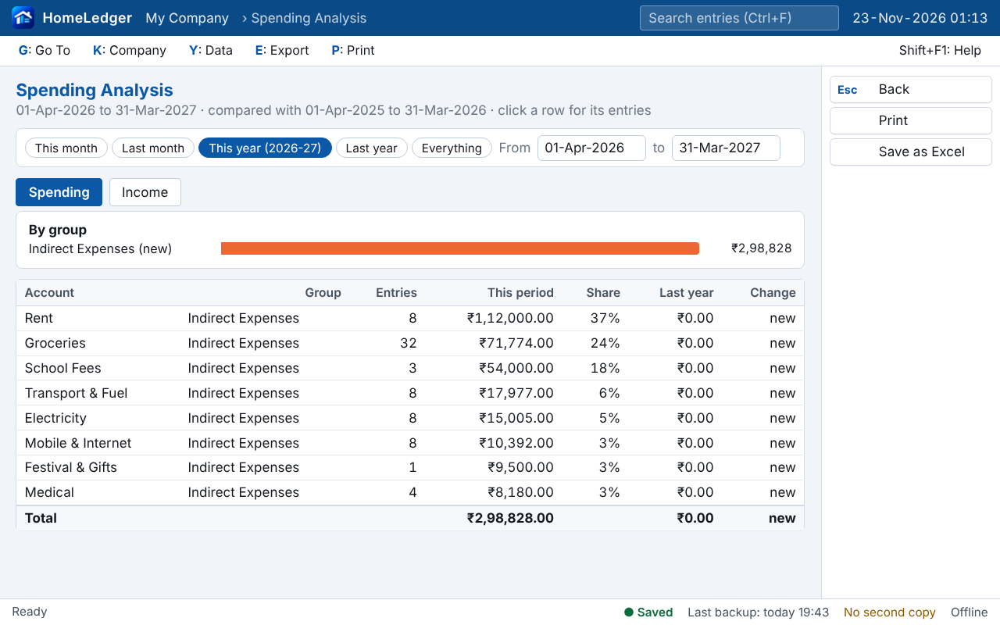

# HomeLedger

**Offline accounting for the home and small business, in the style of Tally.**
Gateway menu, vouchers, ledgers, reports and keyboard shortcuts, running entirely on one Windows PC. No internet, no subscription, nothing sent anywhere.

[](https://github.com/alwinsibym/HomeLedger/actions/workflows/build-installer.yml)


-green)



## Contents

- [Features](#features)
- [Screenshots](#screenshots)
- [Install](#install)
- [First ten minutes](#first-ten-minutes)
- [Keyboard shortcuts](#keyboard-shortcuts)
- [Your data and safety](#your-data-and-safety)
- [Important notes](#important-notes)
- [Run from source](#run-from-source)
- [Tests and building the installer](#tests-and-building-the-installer)
- [Project layout](#project-layout)
- [Documentation](#documentation)
- [Not included](#not-included)
- [Licence](#licence)

## Features

| Area | What you get |
|---|---|
| **Accounting core** | Double-entry vouchers (Payment, Receipt, Contra, Journal, Sales, Purchase, Credit/Debit Note, Memorandum), single-entry mode, cost centres, bill-wise references, post-dated cheques, bank reconciliation, voucher classes, numbering per type per year, optional vouchers |
| **Inventory** | Stock items, groups, godowns, batches and expiry, price lists, bills of materials, pending orders |
| **Reports** | Balance Sheet, Profit & Loss, Trial Balance, Day Book, ledgers, Cash Flow, Fund Flow, ratios, budgets, outstanding bills with ageing, group summary |
| **Insights** | Dashboard with clickable charts, Spending Analysis, Year on Year, "Needs Attention" alerts (overdue bills, TDS due, low stock, repeat entries due, unusual or duplicate entries) |
| **Bringing in old data** | Bill Inbox (photos and PDFs stored in the database and attached to entries), Quick Entry grid, Excel/CSV import with learned auto-categorise rules, Tally XML import and export |
| **Productivity** | Templates and repeat entries, Go To (`Alt+G`), global search (`Ctrl+F`), Tally-style keys, Save as Excel on every report |
| **Printing** | Vouchers and invoices, cheques, party statements, payment-reminder letters |
| **Several companies** | Company list (`F1`), split by date, year-end close with balances carried forward, merge |
| **Tax and payroll (first versions)** | GST (GSTIN checks, CGST/SGST/IGST, GSTR-3B style summary, GSTR-1 lists), TDS (sections, thresholds, deposits and due dates), monthly payroll with payslips |
| **Safety** | Crash-safe saves, automatic backups with an optional second copy, health check, data repair, audit trail, sign-in with roles |
| **Help built in** | First-run tour, step-by-step Guide with screenshots, shortcut map (`Shift+F1`) |

Money is stored as whole paise and quantities in thousandths, so totals never drift by rounding.

## Screenshots

| | |
|---|---|
|  |  |
|  |  |

## Install

1. Open the [Releases](https://github.com/alwinsibym/HomeLedger/releases) page and download `HomeLedger-Setup-<version>.exe` from the newest release.
2. Run it. It installs for the current Windows user only, so no administrator password is needed.
3. Windows may show "Windows protected your PC" because the installer is not digitally signed. Choose **More info**, then **Run anyway**.
4. Tick "Start HomeLedger now" on the last page.

HomeLedger opens in its own window using Microsoft Edge or Google Chrome, which Windows already has. Uninstall it from **Settings, Apps**. The uninstaller asks before touching your accounts, and the default is to keep them.

## First ten minutes

1. `F3` Company Info: type the name and the date the books begin.
2. `M`, then `O` Opening Balances: enter cash, bank, loans and what others owe you. Once.
3. `U` Utilities, Backup: choose a second place for backups, such as a pen drive.
4. `F5` for a payment and `F6` for a receipt. `Ctrl+A` saves.

The in-app Guide (Gateway, `G`) walks through each of these with pictures.

## Keyboard shortcuts

| Key | Does |
|---|---|
| `F4` `F5` `F6` `F7` | Contra, Payment, Receipt, Journal |
| `F8` `F9` | Sales, Purchase |
| `Ctrl+A` | Accept (save) a voucher |
| `Enter` / `Esc` | Next box / go back |
| `Alt+G` | Go To any screen, ledger or report |
| `Ctrl+F` | Search all entries |
| `Alt+F1` | Dashboard |
| `F1` | Company list |
| `Alt+2` / `Alt+T` | Duplicate a voucher / Templates |
| `Ctrl+P` | Print (or Save as PDF) |
| `Shift+F1` | Key list, full guide, quick tour |

The full map is in the [user guide](docs/USER_GUIDE.md#shortcut-map).

## Your data and safety

- Everything stays on the computer, in `%LOCALAPPDATA%\HomeLedger` (database, backups, logs). The program listens only on `127.0.0.1` and never on the network.
- Every entry is saved at once with all-or-nothing writes, so a power cut cannot leave half an entry.
- Backups are made at start, about hourly while working, and on close. A second copy goes to a folder you choose and can be password-protected.
- Entries are cancelled, never deleted, and the audit trail lists every change.
- Optional sign-in with four roles: Owner, Accountant, Data entry and Viewer.
- To move to another PC, install HomeLedger there and restore a backup, or copy the data folder.

## Important notes

- **GST, TDS and payroll are first versions.** Rates, thresholds and rules are a starting point taken from published charts and can be edited. Have an accountant check them before filing returns or paying tax.
- HomeLedger is a personal and small-business tool, not an audited accounting product.
- One computer, one user at a time. There is no network or multi-user mode by design.

## Run from source

Needs Python 3.12 or newer. It uses only the standard library.

```bash
git clone https://github.com/alwinsibym/HomeLedger.git
cd HomeLedger
python HomeLedger.pyw            # opens the app window
python HomeLedger.pyw --no-window   # server only, for testing
```

Useful environment variables: `HOMELEDGER_DATA` (data folder) and `HOMELEDGER_PORT`.

## Tests and building the installer

```bash
python -m unittest tests.test_core tests.test_integration
```

The Windows installer is built by GitHub Actions (`.github/workflows/build-installer.yml`): it runs the tests, packages the app with PyInstaller, builds `Setup.exe` with Inno Setup (`installer/HomeLedger.iss`) and attaches it to a release. Run the workflow from the Actions tab, or push a tag such as `v1.20.0`.

To rebuild the user guide after editing `homeledger/static/guide/guide.json`:

```bash
python tools/make_guide.py
```

## Project layout

```
HomeLedger.pyw        start-up script
homeledger/           application package
  db.py               SQLite schema and upgrades
  service.py          vouchers, ledgers, masters
  reports.py          statements and reports
  gst.py tds.py payroll.py inventory.py companies.py
  attach.py bulk.py templates.py insights.py utilities.py
  server.py           local HTTP API (127.0.0.1 only)
  static/             browser UI (plain JavaScript and SVG) and guide images
installer/            Inno Setup script and wizard artwork
tests/                automated tests
tools/                guide builder, demo-data seeder
docs/                 user guide (Markdown and PDF)
```

Built with Python (standard library), SQLite and a plain JavaScript interface. No frameworks and no packages to download.

## Documentation

- [User guide with screenshots](docs/USER_GUIDE.md) and a [printable PDF](docs/HomeLedger_Guide.pdf)
- Malayalam guide (മലയാളം): [user guide](docs/USER_GUIDE_ML.md) and [printable PDF](docs/HomeLedger_Guide_Malayalam.pdf). Inside the app, the Guide, quick tour and hands-on lessons have an EN / മലയാളം switch.
- In the app: Gateway, `G` (Guide and Help)

## Not included

Network or multi-user access, online banking, cloud sync, and handwriting recognition. These are left out on purpose, to keep the program offline and safe. Old notebooks are brought in through Quick Entry, Bill Inbox and the Excel/CSV import instead.

## Licence

No open-source licence has been chosen yet. All rights are reserved by the author until one is added.
