# HomeLedger Guide

HomeLedger keeps your household or business accounts on this computer only. It never uses the internet, saves after every entry, and makes backups on its own. Press Shift+F1 any time for the key list.

## Contents

- [1. Your first ten minutes](#start)
- [2. Getting around](#around)
- [3. Writing a payment or receipt](#daily)
- [4. Writing many entries at once (Quick Entry)](#quick)
- [5. Keeping bills and receipts (Bill Inbox)](#bills)
- [6. Bringing in old data](#import)
- [7. Seeing where the money went](#dash)
- [8. The books: Day Book, ledgers, Profit & Loss, Balance Sheet](#books)
- [9. Money owed to you and by you](#owed)
- [10. Entries you repeat (Templates)](#templates)
- [11. Keeping your data safe](#backup)
- [12. Passwords and users](#users)
- [13. More than one set of books](#companies)
- [14. GST, TDS and Payroll](#tax)
- [Shortcut map](#shortcut-map)
- [Questions and answers](#questions-and-answers)

## 1. Your first ten minutes

The first screen is the Gateway. Press the letter shown beside each line (M for Masters, T for Transactions, R for Reports...), or use the arrow keys and Enter. Press Esc to go back from any screen.

Step 1: press F3 (Company Info) and type your name and the year your books start.

Step 2: press M for Masters, then O for Opening Balances. Enter what you have today: cash, bank balance, loans you owe, money others owe you. You only do this once.

Step 3: press F5 to write your first payment and F6 for your first receipt. You are now keeping accounts.

> **Good to know:** Everything is saved the moment you press Ctrl+A. There is no Save button to forget. Nothing is ever really deleted. A wrong entry is Cancelled and stays visible in the audit trail.

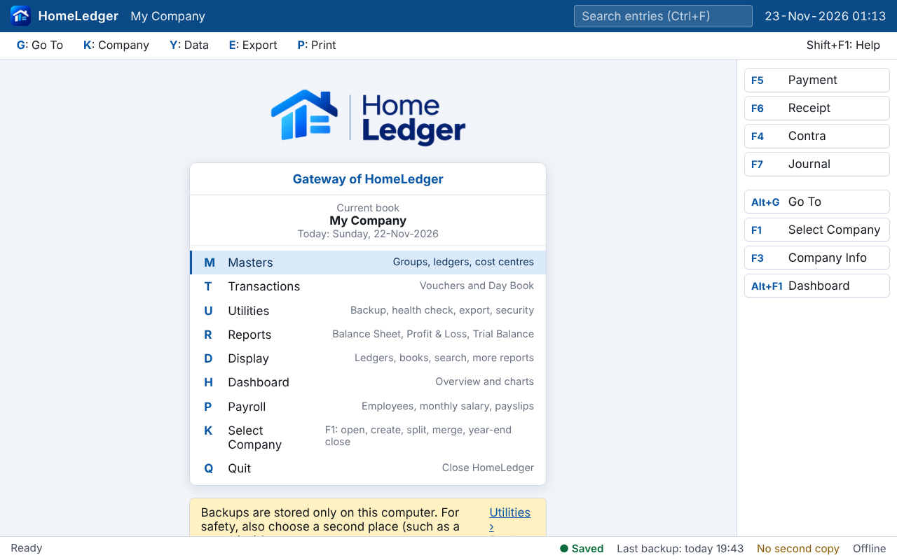

## 2. Getting around

Alt+G (Go To) is the fastest way to move. Press it, type a few letters of any screen, ledger or report and press Enter.

The panel on the right always shows the keys that work on the current screen. You can click them as well.

The bar at the top has G Go To, K Company, Y Data (backup and safety), E Export and P Print. Ctrl+F searches all your entries by words, amount or date.

F1 opens the list of companies (books). Alt+F1 opens the Dashboard.

## 3. Writing a payment or receipt

F5 is a Payment (money going out). F6 is a Receipt (money coming in). F4 is Contra (cash to bank). F7 is Journal (an adjustment between two accounts).

Pick the Cash or Bank account, then type the account the money went to, for example Groceries. If the account does not exist, press Enter on 'Create ledger' and make it on the spot.

Type the amount. Enter moves to the next box. Press Ctrl+A to save, or press Enter on the Narration box.

Made a mistake? Open the entry from the Day Book, change it and save. To remove it, use Cancel.

> **Good to know:** Alt+2 on a saved voucher duplicates it for tomorrow's similar entry. Ctrl+L marks an entry Optional, which does not count in the books until you activate it. 'Date is approximate' is for old notebook entries when you only know the month.

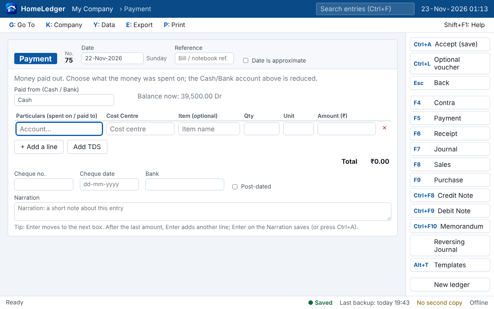

## 4. Writing many entries at once (Quick Entry)

Open Transactions, then Quick Entry (Q). It looks like the notebook page: one line per payment or receipt.

Type the shop or item in the last box and HomeLedger suggests the account from your earlier entries.

Press Enter in the last box to add a new line. Press Ctrl+A to save all the lines together.

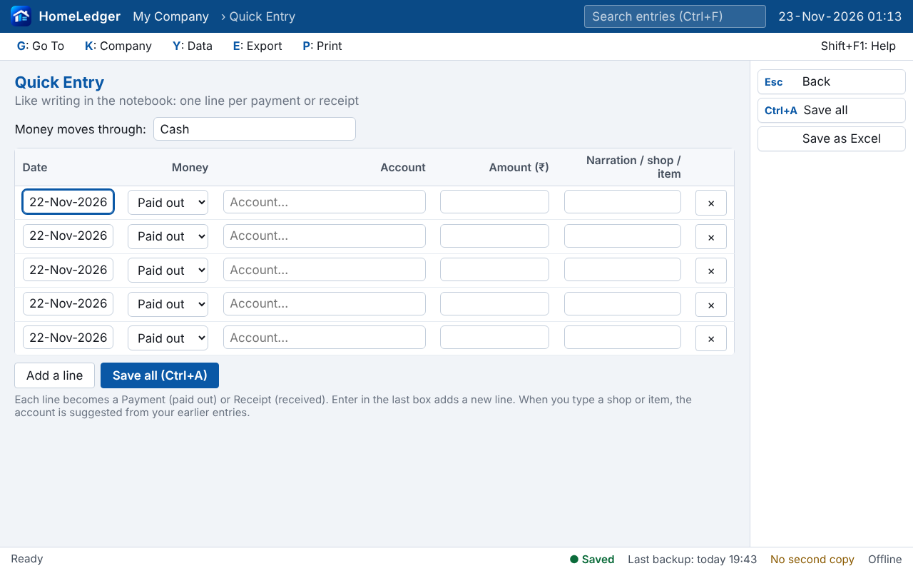

## 5. Keeping bills and receipts (Bill Inbox)

Take a photo of a bill, or use a PDF. Open Transactions, then Bill Inbox (I), and add the pictures.

Look at the picture on one side and type the entry on the other. When you save, the bill is attached to that entry for good.

Any entry also has a 'Bills / receipts' button to see or add pictures later. The pictures live inside the HomeLedger database, so one backup keeps both numbers and bills.

> **Good to know:** Photos are shrunk so the database stays small. The same picture is never added twice.

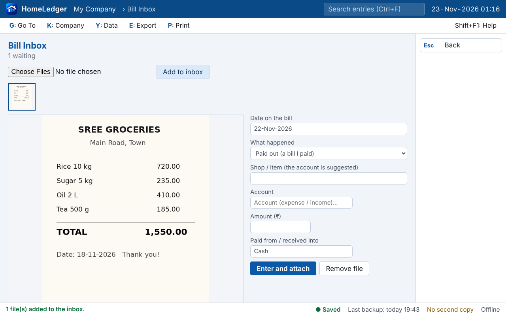

## 6. Bringing in old data

From a typed notebook or bank statement: type or paste it into Excel with a heading row (Date, Description, Debit, Credit, or Date, Description, Amount). Save as CSV or .xlsx. Open Utilities, then Import from Excel / CSV (I).

HomeLedger shows every line before anything is entered. Choose the account for each line. Picking an account for one shop fills the same shop elsewhere. Lines already in the books are left unticked.

Your choices are remembered as rules (Utilities, then Auto-categorise Rules) so next time most lines are filled in for you.

Opening balances for the start of a year are better entered once under Opening Balances than imported line by line.

From Tally: export the vouchers as XML from Tally and use Utilities, then Tally XML. Try a small file first.

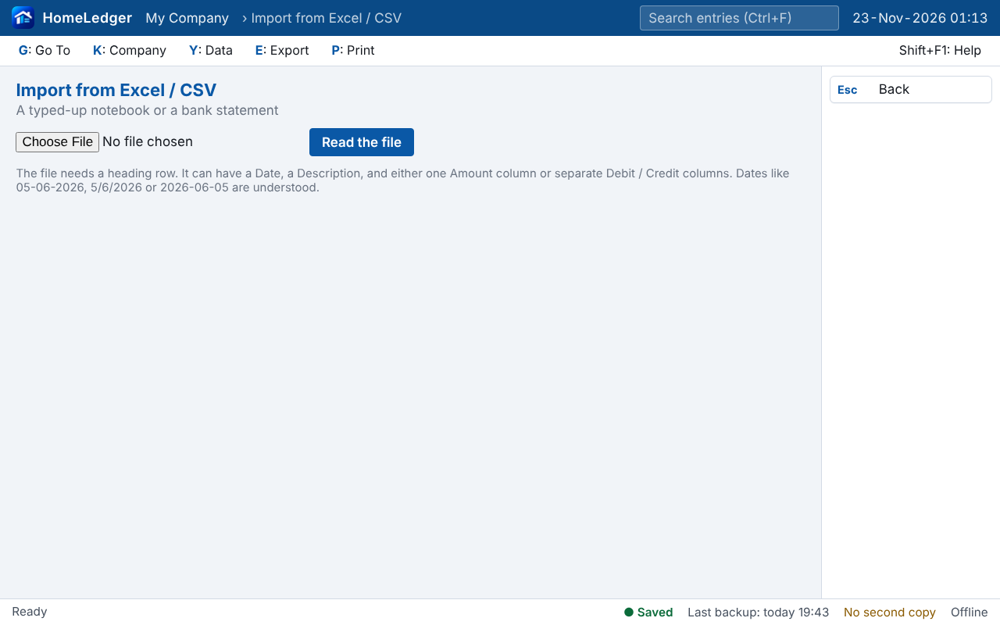

## 7. Seeing where the money went

Press H on the Gateway for the Dashboard: cash, bank, spending, savings, charts and plain-sentence observations. Click any bar or line to see the entries behind it.

Reports, then Spending Analysis (W) shows spending by account, with last year's figure and the change.

Reports, then Year on Year (X) puts this year against last year month by month.

Reports, then Needs Attention (N) lists overdue bills, TDS due, low stock, repeat entries due, and entries that look unusual or duplicated.

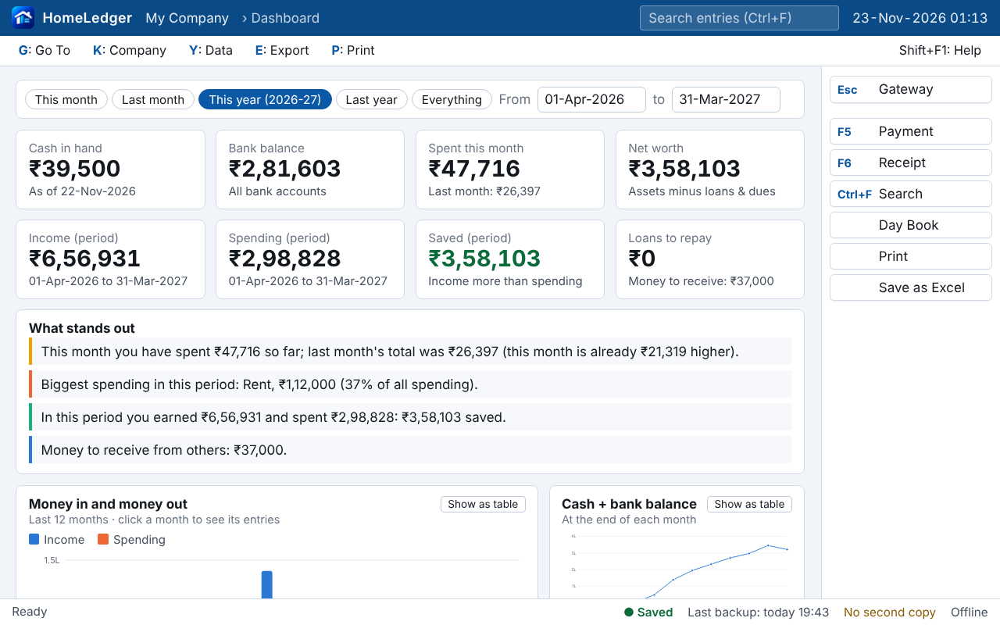

### Spending Analysis

Click any row to see all the entries of that account for the period. Use the period chips at the top to change the dates.

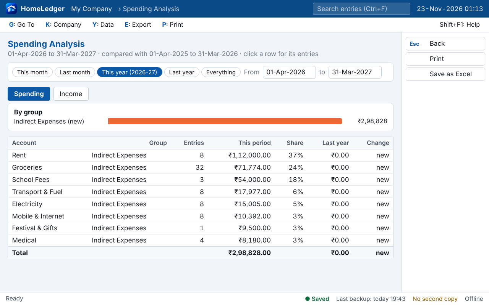

### Needs Attention

Each line has an Open button that takes you to the place to fix it.

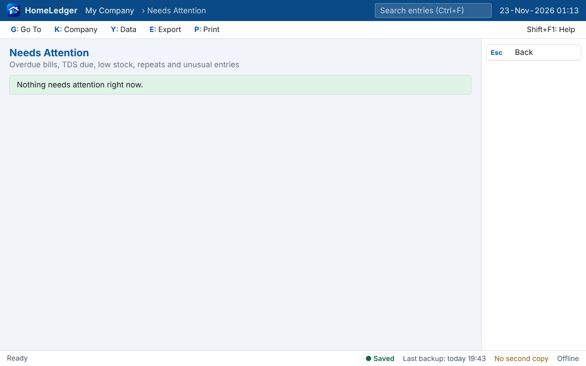

## 8. The books: Day Book, ledgers, Profit & Loss, Balance Sheet

The Day Book lists every entry in date order. Click one to open it.

A Ledger is the statement of one account. Choose Display (D), then Ledger (L), type the name and press Enter. Long statements load a page at a time.

Profit & Loss shows income less spending. The Balance Sheet shows what you own and owe.

Every report has Save as Excel on the right. For a PDF, press Ctrl+P and choose Save as PDF.

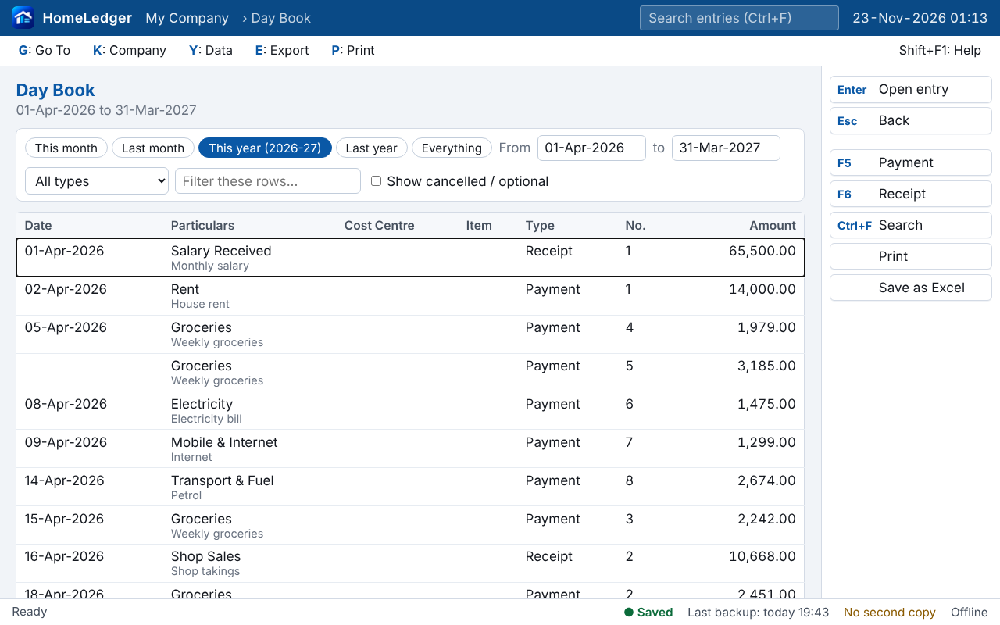

### A ledger statement

Use 'Monthly summary' for a month by month view, and 'Print statement for party' to print an account statement for a customer or supplier.

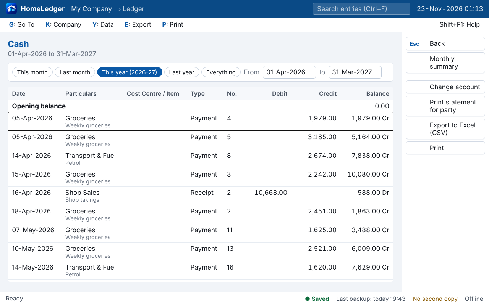

### Profit & Loss

Click any line to open its statement.

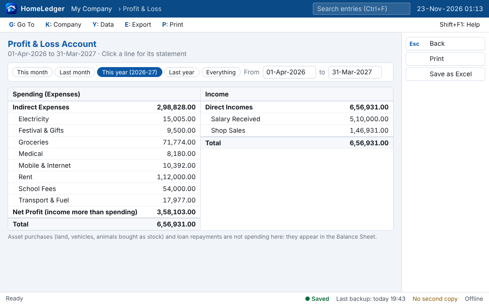

## 9. Money owed to you and by you

Reports, then Outstandings shows who owes you and whom you owe, with how old each amount is.

Select a party and choose 'Reminder letter' to print a payment reminder (or a balance confirmation for suppliers).

When you enter a sale or purchase on credit you can give it a bill reference, and settle it bill by bill later.

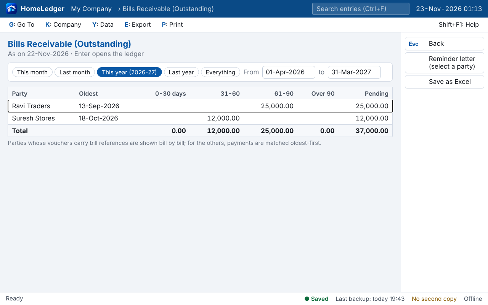

## 10. Entries you repeat (Templates)

Open a saved Payment, Receipt, Contra or Journal and choose 'Save as template'. Give it a name such as Monthly rent.

Use starts a new entry from it. Set it to repeat monthly, weekly, every three months or yearly, and it appears under Due Repeat Entries when it is time. Nothing is ever entered without your tick.

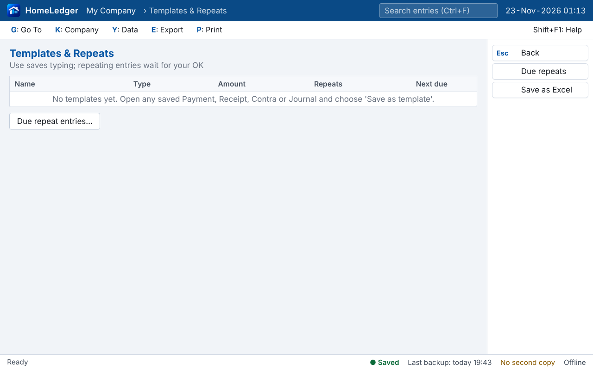

## 11. Keeping your data safe

HomeLedger backs up automatically and keeps the last copies. Open Utilities (U), then Backup and Restore to make a copy now and to choose a second place, such as a pen drive.

The status bar at the bottom shows when the last backup was made and whether a second copy exists. Keep a second copy.

Health Check verifies the data file. Data Repair fixes common problems and always makes a copy first.

Export gives you all your data as Excel files at any time.

> **Good to know:** A backup that has never been opened is only a hope. Once a month, try Restore on a spare copy.

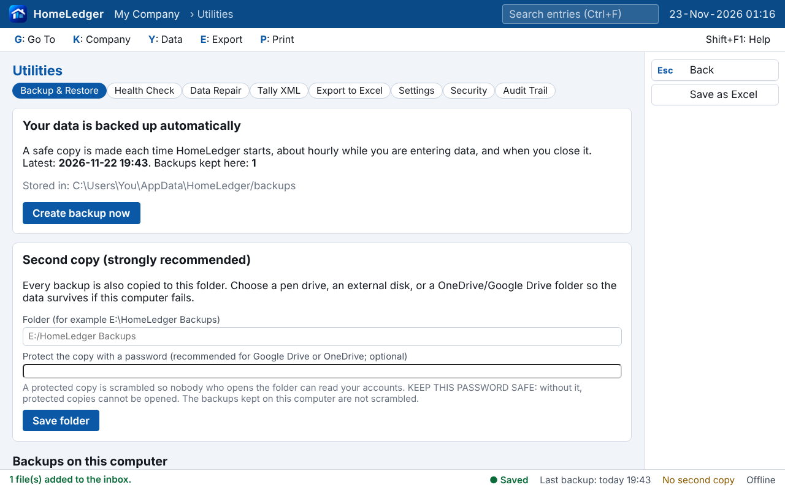

## 12. Passwords and users

By default anyone who opens HomeLedger on this computer can use it. To require a password, open Utilities, then Security, and turn sign-in on. Write the password down and keep it safe.

You can add more people with a role: Owner (everything), Accountant (entries and reports), Data entry (entering vouchers only) and Viewer (read only).

Alt+L locks the screen without closing the books. Only the Owner can restore backups, change companies or run repairs.

> **Good to know:** If sign-in is on and the password is forgotten, the data cannot be opened. Keep the password with the backups.

## 13. More than one set of books

F1 opens the company list. Create a new company, shut the current one, split a company by date, close the year (balances carry forward) or merge books.

Each company has its own backups.

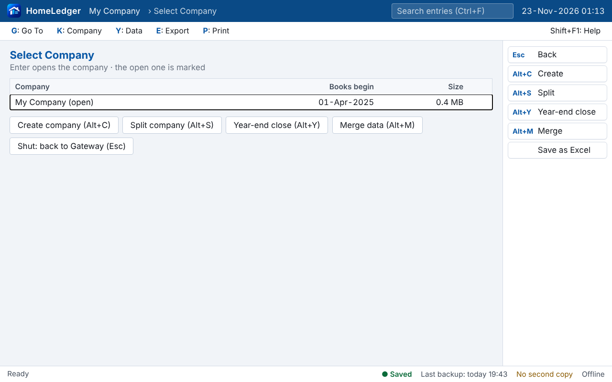

## 14. GST, TDS and Payroll

These are optional. Masters, then GST Setup and TDS Setup turn them on. Payroll is on the Gateway (P).

The rates and rules inside are a starting point. Please have your accountant check them before you file anything.

## Shortcut map

Keys with a plus sign are pressed together: Ctrl+A means hold Ctrl and press A.

### Move around

| Key | What it does |
|---|---|
| `Alt+G` | Go To: jump to any screen, ledger or report |
| `Esc` | Go back one screen |
| `Alt+F1` | Dashboard |
| `F1` | Company list |
| `F3 / Alt+K` | Company info |
| `Ctrl+F` | Search all entries |
| `Shift+F1` | Keys and help |
| `Enter` | Next box / open the selected line |
| `Arrow keys` | Move between lines |

### Enter vouchers

| Key | What it does |
|---|---|
| `F4` | Contra (cash to bank, bank to cash) |
| `F5` | Payment |
| `F6` | Receipt |
| `F7` | Journal |
| `F8` | Sales |
| `F9` | Purchase |
| `Ctrl+F8` | Credit Note |
| `Ctrl+F9` | Debit Note |
| `Ctrl+A` | Accept (save) |
| `Ctrl+L` | Optional voucher |
| `Alt+2` | Duplicate this voucher |
| `Alt+T` | Templates |
| `Alt+P` | Print the saved voucher |

### Reports and data

| Key | What it does |
|---|---|
| `Ctrl+P / Alt+P` | Print this screen |
| `Alt+E` | Export everything to Excel |
| `Alt+Y` | Backup, health check, security |
| `Alt+C` | Create (on lists of items) |
| `Alt+L / Ctrl+L` | Lock the screen (when sign-in is on) |

### Gateway letters

| Key | What it does |
|---|---|
| `M` | Masters |
| `T` | Transactions |
| `U` | Utilities |
| `R` | Reports |
| `D` | Display |
| `H` | Dashboard |
| `P` | Payroll |
| `K` | Select company |
| `Q` | Quit |

### Inside Transactions

| Key | What it does |
|---|---|
| `Q` | Quick Entry |
| `I` | Bill Inbox |
| `T` | Templates and repeats |
| `B` | Day Book |

### Inside Reports

| Key | What it does |
|---|---|
| `N` | Needs Attention |
| `W` | Spending Analysis |
| `X` | Year on Year |
| `B` | Balance Sheet |
| `P` | Profit and Loss |
| `T` | Trial Balance |
| `O` | Outstandings: Receivable |
| `Y` | Outstandings: Payable |

### Inside Utilities

| Key | What it does |
|---|---|
| `B` | Backup and Restore |
| `H` | Health Check |
| `E` | Export |
| `I` | Import from Excel / CSV |
| `R` | Auto-categorise Rules |

## Questions and answers

**The screen text is too small or large.**  
Open Utilities, then Settings, and change the text size.

**I entered something wrong.**  
Open it from the Day Book, correct it and save. To remove it, Cancel it. It stays in the Audit Trail.

**Totals do not match my notebook.**  
Run Utilities, then Health Check. Then look at Day Book for the period for a missing or double entry. Needs Attention lists likely duplicates.

**Can two people use it at the same time?**  
No. HomeLedger is for one computer. Several people can take turns, each with their own sign-in.

**Does it need the internet?**  
No, never. It also never sends your data anywhere.

**The computer crashed while I was typing.**  
Every saved entry is safe. Open HomeLedger again. If it reports a problem, use Utilities, then Data Repair.

**I forgot the password.**  
Without the password the data cannot be opened. This is deliberate. Keep it with your backups.

---

GST, TDS and payroll figures are a starting point. Please have an accountant check them before filing anything.