# HomeLedger ഗൈഡ്

HomeLedger നിങ്ങളുടെ വീട്ടിലെയോ കച്ചവടത്തിലെയോ കണക്കുകൾ ഈ കമ്പ്യൂട്ടറിൽ മാത്രം സൂക്ഷിക്കുന്നു. ഇന്റർനെറ്റ് ഒരിക്കലും ഉപയോഗിക്കില്ല, ഓരോ എൻട്രിക്കു ശേഷവും സേവ് ചെയ്യും, ബാക്കപ്പ് സ്വയം എടുക്കും. കീകളുടെ പട്ടിക കാണാൻ എപ്പോൾ വേണമെങ്കിലും Shift+F1 അമർത്തുക.

> ഈ മലയാളം പരിഭാഷ ആദ്യ പതിപ്പാണ്. മലയാളം നന്നായി അറിയുന്ന ഒരാൾ വായിച്ചു തിരുത്തുന്നത് നല്ലതാണ്.

## ഉള്ളടക്കം

- [1. ആദ്യത്തെ പത്തു മിനിറ്റ്](#start)
- [2. സ്ക്രീനുകൾക്കിടയിൽ നീങ്ങാം](#around)
- [3. Payment, Receipt എഴുതുന്നത്](#daily)
- [4. ഒരുപാട് എൻട്രികൾ ഒരുമിച്ച് (Quick Entry)](#quick)
- [5. ബില്ലുകളും രസീതുകളും സൂക്ഷിക്കാം (Bill Inbox)](#bills)
- [6. പഴയ ഡാറ്റ കൊണ്ടുവരാം](#import)
- [7. പണം എവിടെ പോയി എന്ന് കാണാം](#dash)
- [8. കണക്കുപുസ്തകങ്ങൾ: Day Book, ledger, Profit & Loss, Balance Sheet](#books)
- [9. നിങ്ങൾക്ക് കിട്ടാനുള്ളതും കൊടുക്കാനുള്ളതും](#owed)
- [10. ആവർത്തിക്കുന്ന എൻട്രികൾ (Templates)](#templates)
- [11. ഡാറ്റ സുരക്ഷിതമായി സൂക്ഷിക്കാം](#backup)
- [12. പാസ്‌വേഡും ഉപയോക്താക്കളും](#users)
- [13. ഒന്നിലധികം കണക്കുപുസ്തകങ്ങൾ](#companies)
- [14. GST, TDS, ശമ്പളം (Payroll)](#tax)
- [ഷോർട്ട്കട്ട് കീകൾ](#shortcut-map)
- [ചോദ്യങ്ങളും ഉത്തരങ്ങളും](#questions-and-answers)

## 1. ആദ്യത്തെ പത്തു മിനിറ്റ്

ആദ്യം കാണുന്ന സ്ക്രീനാണ് Gateway. ഓരോ വരിയുടെയും അരികിലുള്ള അക്ഷരം അമർത്തുക (Masters-ന് M, Transactions-ന് T, Reports-ന് R...). അല്ലെങ്കിൽ ആരോ കീകളും Enter-ഉം ഉപയോഗിക്കാം. ഏത് സ്ക്രീനിൽ നിന്നും പിന്നിലേക്ക് പോകാൻ Esc അമർത്തുക.

ഒന്നാം ഘട്ടം: F3 (Company Info) അമർത്തി നിങ്ങളുടെ പേരും കണക്ക് തുടങ്ങുന്ന വർഷവും ടൈപ്പ് ചെയ്യുക.

രണ്ടാം ഘട്ടം: M അമർത്തി Masters തുറക്കുക, പിന്നെ O (Opening Balances). ഇന്ന് നിങ്ങളുടെ കൈവശമുള്ളത് നൽകുക: കയ്യിലെ പണം, ബാങ്ക് ബാലൻസ്, നിങ്ങൾ കൊടുക്കാനുള്ള കടം, മറ്റുള്ളവർ നിങ്ങൾക്ക് തരാനുള്ള പണം. ഇത് ഒരു തവണ മാത്രം ചെയ്താൽ മതി.

മൂന്നാം ഘട്ടം: ആദ്യത്തെ Payment എഴുതാൻ F5-ഉം ആദ്യത്തെ Receipt-ന് F6-ഉം അമർത്തുക. ഇപ്പോൾ നിങ്ങൾ കണക്ക് എഴുതിത്തുടങ്ങി.

> **അറിയേണ്ടത്:** Ctrl+A അമർത്തുമ്പോൾ തന്നെ എല്ലാം സേവ് ആകും. മറന്നുപോകാൻ Save ബട്ടൺ ഇല്ല. ഒന്നും ശരിക്കും മായ്ക്കപ്പെടുന്നില്ല. തെറ്റായ എൻട്രി Cancel ചെയ്താൽ അത് ഓഡിറ്റ് ട്രെയിലിൽ കാണാം.

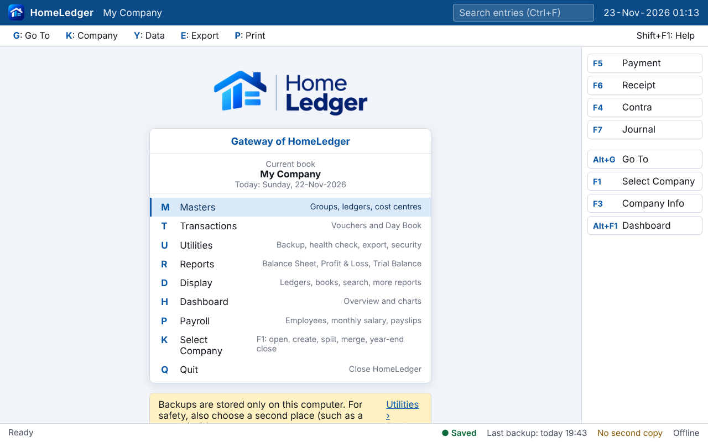

## 2. സ്ക്രീനുകൾക്കിടയിൽ നീങ്ങാം

Alt+G (Go To) ആണ് ഏറ്റവും വേഗത്തിൽ പോകാനുള്ള വഴി. അത് അമർത്തി ഏതെങ്കിലും സ്ക്രീനിന്റെയോ ledger-ന്റെയോ റിപ്പോർട്ടിന്റെയോ ഏതാനും അക്ഷരങ്ങൾ ടൈപ്പ് ചെയ്ത് Enter അമർത്തുക.

വലതുവശത്തെ പാനൽ ഇപ്പോഴത്തെ സ്ക്രീനിൽ പ്രവർത്തിക്കുന്ന കീകൾ എപ്പോഴും കാണിക്കും. അവയിൽ ക്ലിക്ക് ചെയ്യുകയും ചെയ്യാം.

മുകളിലെ ബാറിൽ G Go To, K Company, Y Data (ബാക്കപ്പും സുരക്ഷയും), E Export, P Print എന്നിവയുണ്ട്. Ctrl+F വാക്ക്, തുക, തീയതി എന്നിവ വച്ച് എല്ലാ എൻട്രികളിലും തിരയും.

F1 കമ്പനികളുടെ (പുസ്തകങ്ങളുടെ) പട്ടിക തുറക്കും. Alt+F1 Dashboard തുറക്കും.

## 3. Payment, Receipt എഴുതുന്നത്

F5 Payment ആണ് (പണം പുറത്തേക്ക് പോകുന്നത്). F6 Receipt ആണ് (പണം അകത്തേക്ക് വരുന്നത്). F4 Contra (പണം ബാങ്കിലേക്ക് / ബാങ്കിൽ നിന്ന് പണത്തിലേക്ക്). F7 Journal (രണ്ട് അക്കൗണ്ടുകൾക്കിടയിലെ ക്രമീകരണം).

Cash അല്ലെങ്കിൽ Bank അക്കൗണ്ട് തിരഞ്ഞെടുക്കുക. എന്നിട്ട് പണം പോയ അക്കൗണ്ട് ടൈപ്പ് ചെയ്യുക, ഉദാഹരണത്തിന് Groceries. ആ അക്കൗണ്ട് ഇല്ലെങ്കിൽ 'Create ledger'-ൽ Enter അമർത്തി അപ്പോൾ തന്നെ ഉണ്ടാക്കാം.

തുക ടൈപ്പ് ചെയ്യുക. Enter അമർത്തിയാൽ അടുത്ത കള്ളിയിലേക്ക് പോകും. സേവ് ചെയ്യാൻ Ctrl+A അമർത്തുക, അല്ലെങ്കിൽ Narration കള്ളിയിൽ Enter അമർത്തുക.

തെറ്റ് പറ്റിയോ? Day Book-ൽ നിന്ന് ആ എൻട്രി തുറന്ന് മാറ്റി വീണ്ടും സേവ് ചെയ്യുക. ഒഴിവാക്കാൻ Cancel ഉപയോഗിക്കുക.

> **അറിയേണ്ടത്:** സേവ് ചെയ്ത voucher-ൽ Alt+2 അമർത്തിയാൽ നാളത്തെ സമാനമായ എൻട്രിക്കായി അതിന്റെ പകർപ്പ് കിട്ടും. Ctrl+L ഒരു എൻട്രിയെ Optional ആക്കും. അത് നിങ്ങൾ activate ചെയ്യുന്നതുവരെ കണക്കിൽ വരില്ല. 'Date is approximate' പഴയ നോട്ടുബുക്ക് എൻട്രികൾക്കാണ്, മാസം മാത്രം അറിയുമ്പോൾ.

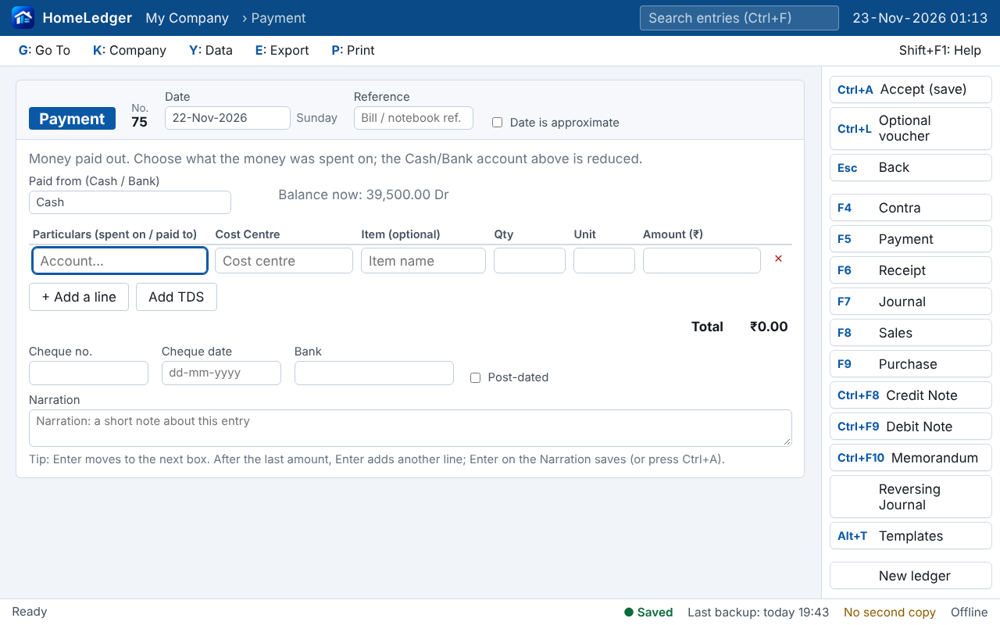

## 4. ഒരുപാട് എൻട്രികൾ ഒരുമിച്ച് (Quick Entry)

Transactions തുറന്ന് Quick Entry (Q) തിരഞ്ഞെടുക്കുക. ഇത് നോട്ടുബുക്ക് താൾ പോലെയാണ്: ഓരോ payment-നും receipt-നും ഒരു വരി.

അവസാനത്തെ കള്ളിയിൽ കടയുടെയോ സാധനത്തിന്റെയോ പേര് ടൈപ്പ് ചെയ്യുക. നിങ്ങളുടെ മുൻ എൻട്രികൾ നോക്കി HomeLedger അക്കൗണ്ട് നിർദ്ദേശിക്കും.

അവസാനത്തെ കള്ളിയിൽ Enter അമർത്തിയാൽ പുതിയ വരി വരും. എല്ലാ വരികളും ഒരുമിച്ച് സേവ് ചെയ്യാൻ Ctrl+A അമർത്തുക.

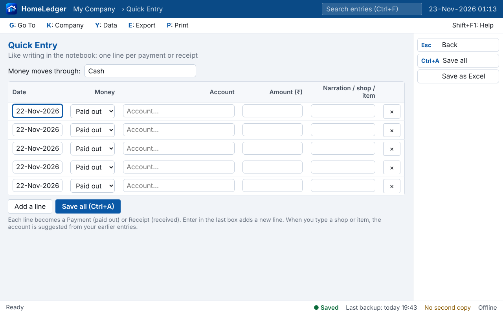

## 5. ബില്ലുകളും രസീതുകളും സൂക്ഷിക്കാം (Bill Inbox)

ബില്ലിന്റെ ഫോട്ടോ എടുക്കുക, അല്ലെങ്കിൽ PDF ഉപയോഗിക്കുക. Transactions തുറന്ന് Bill Inbox (I) എടുത്ത് ചിത്രങ്ങൾ ചേർക്കുക.

ഒരു വശത്ത് ചിത്രം നോക്കി മറുവശത്ത് എൻട്രി ടൈപ്പ് ചെയ്യുക. സേവ് ചെയ്യുമ്പോൾ ആ ബിൽ ആ എൻട്രിയിൽ എന്നെന്നേക്കുമായി ചേരും.

ഏത് എൻട്രിക്കും 'Bills / receipts' ബട്ടൺ ഉണ്ട്, ചിത്രങ്ങൾ പിന്നീട് കാണാനും ചേർക്കാനും. ചിത്രങ്ങൾ HomeLedger ഡാറ്റാബേസിനുള്ളിൽ തന്നെയാണ്, അതുകൊണ്ട് ഒരു ബാക്കപ്പ് മതി അക്കങ്ങളും ബില്ലുകളും സൂക്ഷിക്കാൻ.

> **അറിയേണ്ടത്:** ഡാറ്റാബേസ് ചെറുതായിരിക്കാൻ ഫോട്ടോകൾ ചെറുതാക്കി സൂക്ഷിക്കും. ഒരേ ചിത്രം രണ്ടു തവണ ചേർക്കില്ല.

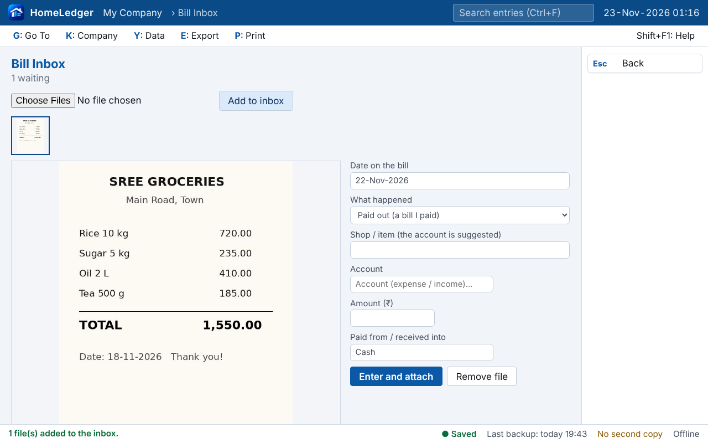

## 6. പഴയ ഡാറ്റ കൊണ്ടുവരാം

ടൈപ്പ് ചെയ്ത നോട്ടുബുക്കിൽ നിന്നോ ബാങ്ക് സ്റ്റേറ്റ്മെന്റിൽ നിന്നോ: Excel-ൽ ടൈപ്പ് ചെയ്യുകയോ പേസ്റ്റ് ചെയ്യുകയോ ചെയ്യുക, മുകളിൽ തലക്കെട്ട് വരിയോടെ (Date, Description, Debit, Credit, അല്ലെങ്കിൽ Date, Description, Amount). CSV അല്ലെങ്കിൽ .xlsx ആയി സേവ് ചെയ്യുക. Utilities തുറന്ന് Import from Excel / CSV (I) എടുക്കുക.

ഒന്നും എൻട്രി ആകുന്നതിനു മുമ്പ് HomeLedger എല്ലാ വരികളും കാണിക്കും. ഓരോ വരിക്കും അക്കൗണ്ട് തിരഞ്ഞെടുക്കുക. ഒരു കടയ്ക്ക് അക്കൗണ്ട് തിരഞ്ഞെടുത്താൽ അതേ കടയുടെ മറ്റ് വരികളിലും അത് നിറയും. കണക്കിൽ ഇതിനകം ഉള്ള വരികൾ ടിക്ക് ഇടാതെ വിടും.

നിങ്ങളുടെ തിരഞ്ഞെടുപ്പുകൾ നിയമങ്ങളായി (Utilities, പിന്നെ Auto-categorise Rules) ഓർത്തുവയ്ക്കും, അടുത്ത തവണ മിക്ക വരികളും സ്വയം നിറയാൻ.

വർഷത്തിന്റെ തുടക്കത്തിലെ ബാലൻസുകൾ വരി വരിയായി import ചെയ്യുന്നതിനേക്കാൾ Opening Balances-ൽ ഒരു തവണ നൽകുന്നതാണ് നല്ലത്.

Tally-യിൽ നിന്ന്: Tally-യിൽ നിന്ന് voucher-കൾ XML ആയി export ചെയ്ത് Utilities, പിന്നെ Tally XML ഉപയോഗിക്കുക. ആദ്യം ഒരു ചെറിയ ഫയൽ പരീക്ഷിക്കുക.

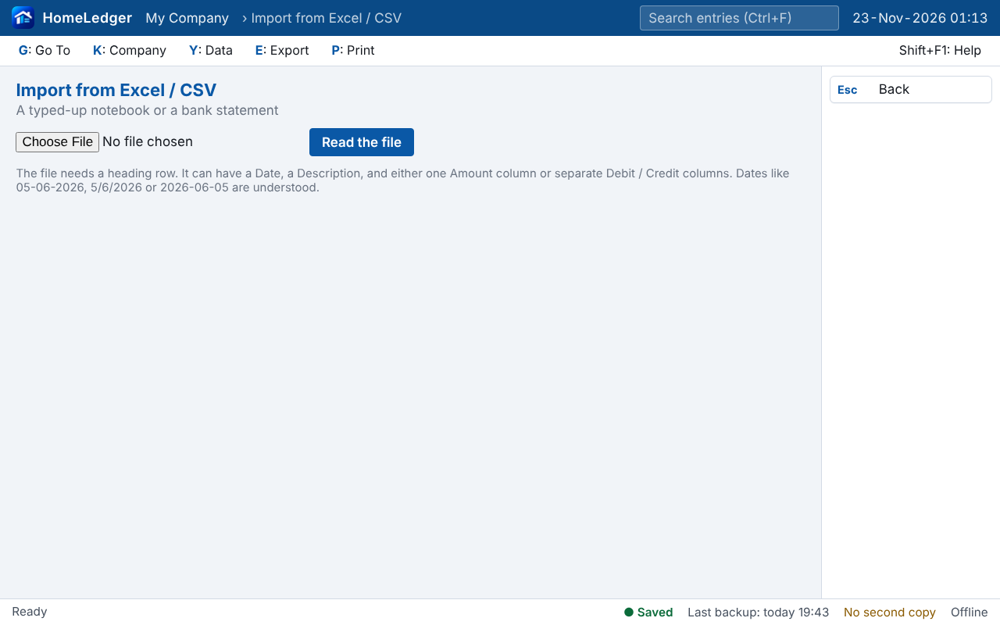

## 7. പണം എവിടെ പോയി എന്ന് കാണാം

Gateway-യിൽ H അമർത്തിയാൽ Dashboard കാണാം: പണം, ബാങ്ക്, ചെലവ്, സമ്പാദ്യം, ചാർട്ടുകൾ, ലളിതമായ വാചകങ്ങളിൽ നിരീക്ഷണങ്ങൾ. ഏതെങ്കിലും ബാറിലോ വരയിലോ ക്ലിക്ക് ചെയ്താൽ അതിന് പിന്നിലെ എൻട്രികൾ കാണാം.

Reports, പിന്നെ Spending Analysis (W) ഓരോ അക്കൗണ്ടിലെയും ചെലവും കഴിഞ്ഞ വർഷത്തെ തുകയും മാറ്റവും കാണിക്കും.

Reports, പിന്നെ Year on Year (X) ഈ വർഷത്തെ കഴിഞ്ഞ വർഷവുമായി മാസം തോറും താരതമ്യം ചെയ്യും.

Reports, പിന്നെ Needs Attention (N) കുടിശ്ശികയായ ബില്ലുകൾ, TDS അടയ്ക്കാനുള്ളത്, സ്റ്റോക്ക് കുറവ്, ആവർത്തന എൻട്രികൾ, അസാധാരണമോ ഇരട്ടിച്ചതോ ആയി തോന്നുന്ന എൻട്രികൾ എന്നിവ കാണിക്കും.

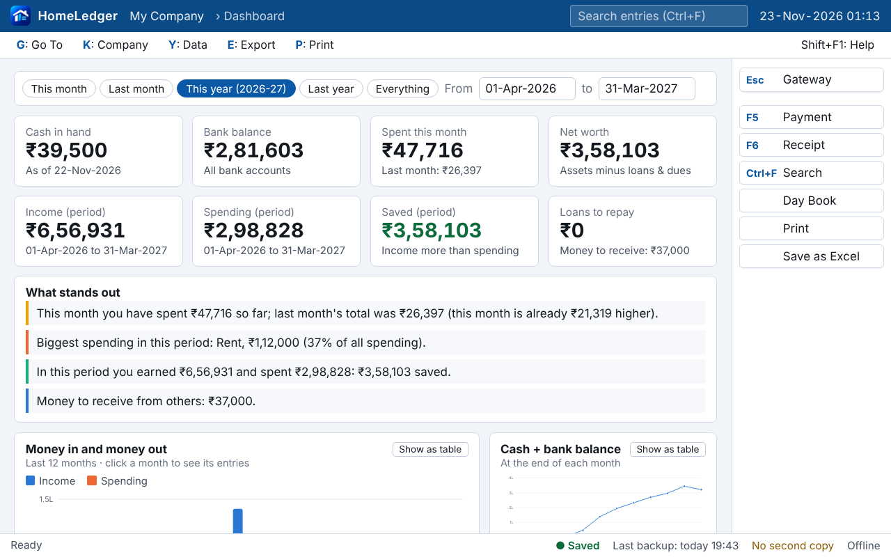

### Spending Analysis

ഏത് വരിയിലും ക്ലിക്ക് ചെയ്താൽ ആ കാലയളവിലെ ആ അക്കൗണ്ടിന്റെ എല്ലാ എൻട്രികളും കാണാം. തീയതി മാറ്റാൻ മുകളിലെ period ചിപ്പുകൾ ഉപയോഗിക്കുക.

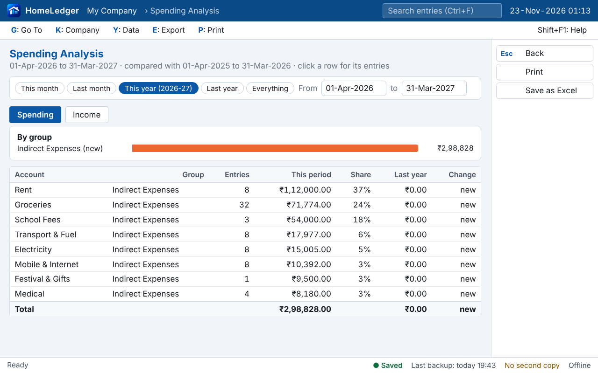

### Needs Attention

ഓരോ വരിയിലും Open ബട്ടൺ ഉണ്ട്, തിരുത്തേണ്ട സ്ഥലത്തേക്ക് അത് കൊണ്ടുപോകും.

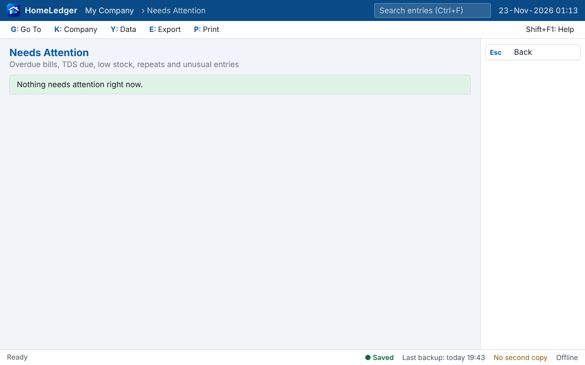

## 8. കണക്കുപുസ്തകങ്ങൾ: Day Book, ledger, Profit & Loss, Balance Sheet

Day Book എല്ലാ എൻട്രികളും തീയതി ക്രമത്തിൽ കാണിക്കും. ഒന്നിൽ ക്ലിക്ക് ചെയ്താൽ അത് തുറക്കും.

Ledger എന്നത് ഒരു അക്കൗണ്ടിന്റെ സ്റ്റേറ്റ്മെന്റ് ആണ്. Display (D), പിന്നെ Ledger (L) തിരഞ്ഞെടുത്ത് പേര് ടൈപ്പ് ചെയ്ത് Enter അമർത്തുക. നീണ്ട സ്റ്റേറ്റ്മെന്റുകൾ ഒരു പേജ് വീതം ലോഡ് ആകും.

Profit & Loss വരുമാനത്തിൽ നിന്ന് ചെലവ് കുറച്ചത് കാണിക്കും. Balance Sheet നിങ്ങൾക്കുള്ളതും നിങ്ങൾ കൊടുക്കാനുള്ളതും കാണിക്കും.

ഓരോ റിപ്പോർട്ടിനും വലതുവശത്ത് Save as Excel ഉണ്ട്. PDF വേണമെങ്കിൽ Ctrl+P അമർത്തി Save as PDF തിരഞ്ഞെടുക്കുക.

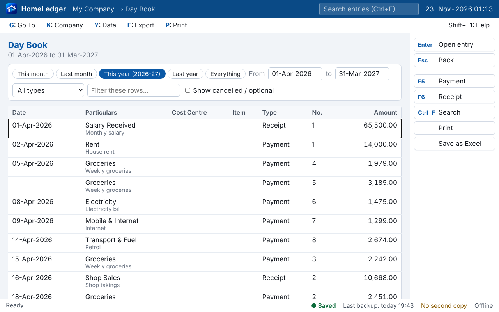

### Ledger സ്റ്റേറ്റ്മെന്റ്

'Monthly summary' മാസം തോറുമുള്ള കാഴ്ച തരും. 'Print statement for party' ഒരു കസ്റ്റമർക്കോ സപ്ലയർക്കോ അക്കൗണ്ട് സ്റ്റേറ്റ്മെന്റ് പ്രിന്റ് ചെയ്യാനാണ്.

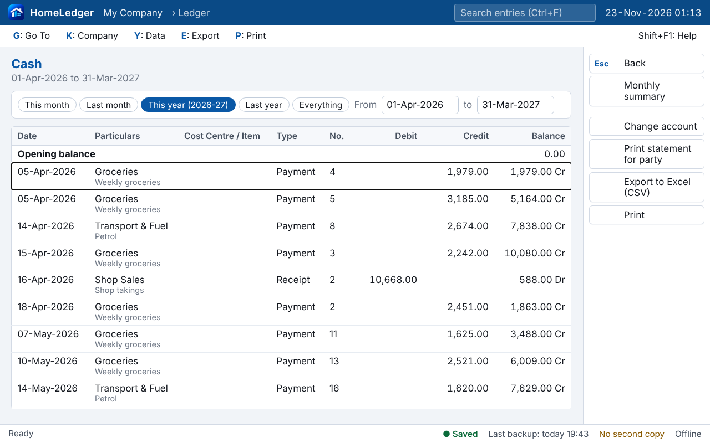

### Profit & Loss

ഏത് വരിയിലും ക്ലിക്ക് ചെയ്താൽ അതിന്റെ സ്റ്റേറ്റ്മെന്റ് തുറക്കും.

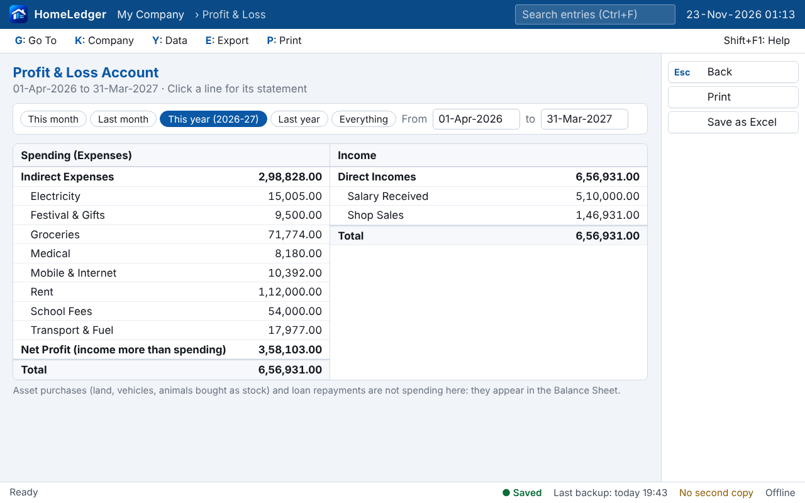

## 9. നിങ്ങൾക്ക് കിട്ടാനുള്ളതും കൊടുക്കാനുള്ളതും

Reports, പിന്നെ Outstandings: ആരൊക്കെ നിങ്ങൾക്ക് തരാനുണ്ട്, നിങ്ങൾ ആർക്കൊക്കെ കൊടുക്കാനുണ്ട്, ഓരോ തുകയ്ക്കും എത്ര പഴക്കമുണ്ട് എന്ന് കാണിക്കും.

ഒരാളെ തിരഞ്ഞെടുത്ത് 'Reminder letter' എടുത്താൽ പണം ചോദിച്ചുള്ള കത്ത് പ്രിന്റ് ചെയ്യാം (സപ്ലയർമാർക്ക് ബാലൻസ് സ്ഥിരീകരണ കത്ത്).

കടമായി വിൽക്കുമ്പോഴോ വാങ്ങുമ്പോഴോ ബിൽ റഫറൻസ് നൽകാം, പിന്നീട് ബിൽ ബിൽ ആയി തീർപ്പാക്കാം.

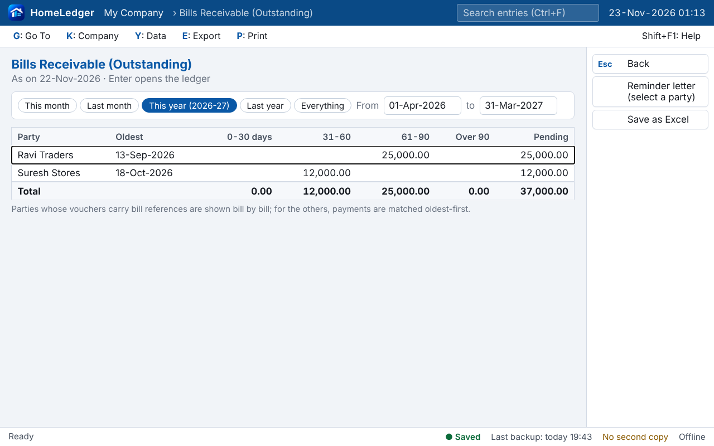

## 10. ആവർത്തിക്കുന്ന എൻട്രികൾ (Templates)

സേവ് ചെയ്ത Payment, Receipt, Contra അല്ലെങ്കിൽ Journal തുറന്ന് 'Save as template' എടുക്കുക. 'Monthly rent' പോലെ ഒരു പേര് നൽകുക.

Use അതിൽ നിന്ന് പുതിയ എൻട്രി തുടങ്ങും. ആഴ്ച തോറും, മാസം തോറും, മൂന്നു മാസം കൂടുമ്പോൾ, വർഷം തോറും എന്ന് repeat നൽകാം. സമയമാകുമ്പോൾ അത് Due Repeat Entries-ൽ വരും. നിങ്ങൾ ടിക്ക് ചെയ്യാതെ ഒന്നും എൻട്രി ആകില്ല.

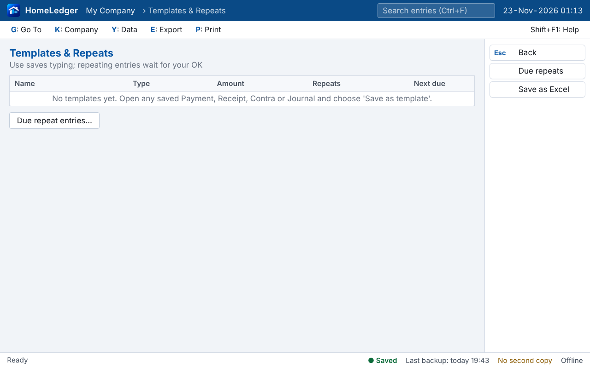

## 11. ഡാറ്റ സുരക്ഷിതമായി സൂക്ഷിക്കാം

HomeLedger സ്വയം ബാക്കപ്പ് എടുക്കുകയും അവസാന പകർപ്പുകൾ സൂക്ഷിക്കുകയും ചെയ്യും. ഇപ്പോൾ ഒരു പകർപ്പ് എടുക്കാനും പെൻഡ്രൈവ് പോലെ രണ്ടാമത്തെ സ്ഥലം തിരഞ്ഞെടുക്കാനും Utilities (U), പിന്നെ Backup and Restore തുറക്കുക.

താഴത്തെ സ്റ്റാറ്റസ് ബാർ അവസാന ബാക്കപ്പ് എപ്പോഴായിരുന്നു എന്നും രണ്ടാമത്തെ പകർപ്പ് ഉണ്ടോ എന്നും കാണിക്കും. ഒരു രണ്ടാമത്തെ പകർപ്പ് സൂക്ഷിക്കുക.

Health Check ഡാറ്റ ഫയൽ പരിശോധിക്കും. Data Repair സാധാരണ പ്രശ്നങ്ങൾ ശരിയാക്കും, അതിനു മുമ്പ് എപ്പോഴും ഒരു പകർപ്പ് എടുക്കും.

Export നിങ്ങളുടെ എല്ലാ ഡാറ്റയും ഏത് സമയത്തും Excel ഫയലുകളായി തരും.

> **അറിയേണ്ടത്:** ഒരിക്കലും തുറന്നു നോക്കാത്ത ബാക്കപ്പ് ഒരു പ്രതീക്ഷ മാത്രമാണ്. മാസത്തിൽ ഒരിക്കൽ ഒരു ഒഴിഞ്ഞ പകർപ്പിൽ Restore പരീക്ഷിക്കുക.

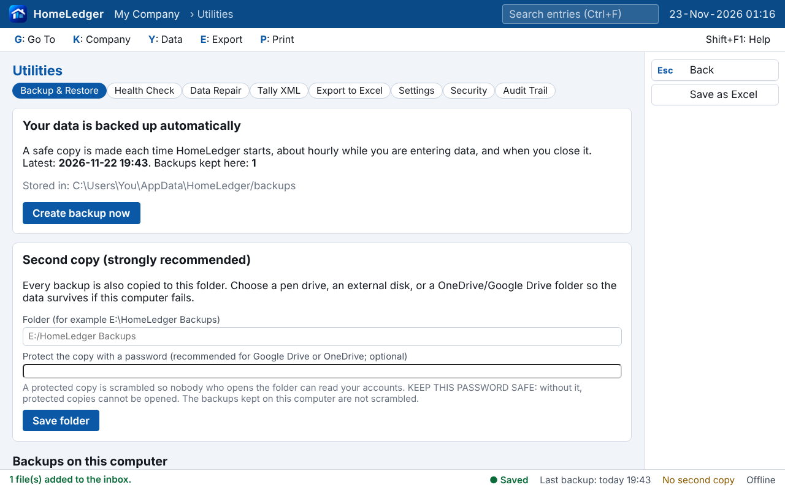

## 12. പാസ്‌വേഡും ഉപയോക്താക്കളും

സാധാരണ നിലയിൽ ഈ കമ്പ്യൂട്ടറിൽ HomeLedger തുറക്കുന്ന ആർക്കും ഉപയോഗിക്കാം. പാസ്‌വേഡ് വേണമെങ്കിൽ Utilities, പിന്നെ Security തുറന്ന് sign-in ഓൺ ചെയ്യുക. പാസ്‌വേഡ് എഴുതി സുരക്ഷിതമായി സൂക്ഷിക്കുക.

കൂടുതൽ ആളുകളെ റോൾ സഹിതം ചേർക്കാം: Owner (എല്ലാം), Accountant (എൻട്രികളും റിപ്പോർട്ടുകളും), Data entry (voucher എൻട്രി മാത്രം), Viewer (കാണാൻ മാത്രം).

Alt+L പുസ്തകങ്ങൾ അടയ്ക്കാതെ സ്ക്രീൻ ലോക്ക് ചെയ്യും. ബാക്കപ്പ് restore ചെയ്യാനും കമ്പനി മാറ്റാനും repair ചെയ്യാനും Owner-ന് മാത്രമേ കഴിയൂ.

> **അറിയേണ്ടത്:** sign-in ഓൺ ആയിരിക്കെ പാസ്‌വേഡ് മറന്നാൽ ഡാറ്റ തുറക്കാനാകില്ല. പാസ്‌വേഡ് ബാക്കപ്പുകളോടൊപ്പം സൂക്ഷിക്കുക.

## 13. ഒന്നിലധികം കണക്കുപുസ്തകങ്ങൾ

F1 കമ്പനി പട്ടിക തുറക്കും. പുതിയ കമ്പനി ഉണ്ടാക്കാം, ഇപ്പോഴത്തേത് അടയ്ക്കാം, തീയതി വച്ച് കമ്പനിയെ വിഭജിക്കാം, വർഷം അവസാനിപ്പിക്കാം (ബാലൻസുകൾ അടുത്ത വർഷത്തിലേക്ക് പോകും), അല്ലെങ്കിൽ പുസ്തകങ്ങൾ ഒന്നിപ്പിക്കാം.

ഓരോ കമ്പനിക്കും അതിന്റേതായ ബാക്കപ്പുകൾ ഉണ്ട്.

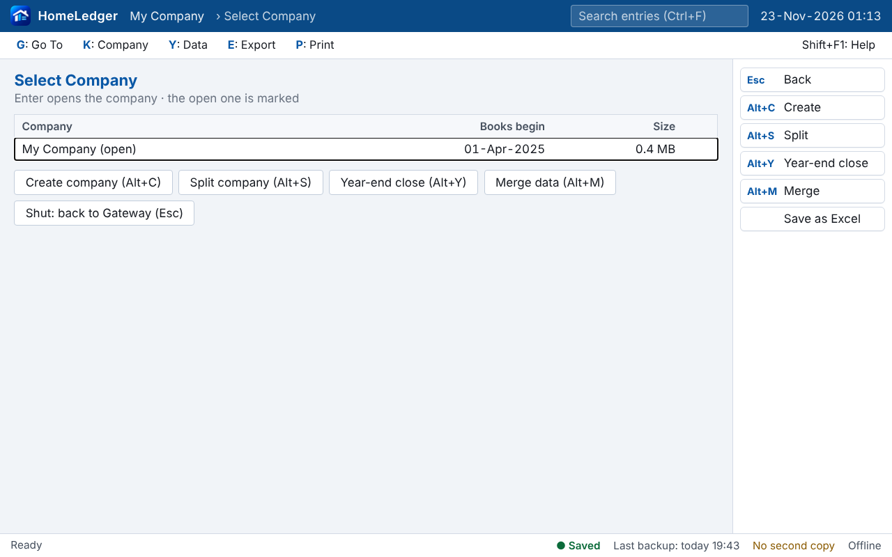

## 14. GST, TDS, ശമ്പളം (Payroll)

ഇവ നിർബന്ധമല്ല. Masters, പിന്നെ GST Setup, TDS Setup എന്നിവ ഇവ ഓൺ ചെയ്യും. Payroll Gateway-യിൽ (P) ഉണ്ട്.

ഇതിലെ നിരക്കുകളും നിയമങ്ങളും ഒരു തുടക്കം മാത്രമാണ്. എന്തെങ്കിലും ഫയൽ ചെയ്യുന്നതിനു മുമ്പ് നിങ്ങളുടെ അക്കൗണ്ടന്റിനെ കൊണ്ട് പരിശോധിപ്പിക്കുക.

## ഷോർട്ട്കട്ട് കീകൾ

പ്ലസ് ചിഹ്നമുള്ള കീകൾ ഒരുമിച്ച് അമർത്തണം. ഉദാഹരണത്തിന് Ctrl+A എന്നാൽ Ctrl പിടിച്ചുകൊണ്ട് A അമർത്തുക.

### സ്ക്രീനുകൾക്കിടയിൽ നീങ്ങാൻ

| കീ | എന്ത് ചെയ്യും |
|---|---|
| `Alt+G` | Go To: ഏത് സ്ക്രീനിലേക്കും ledger-ലേക്കും റിപ്പോർട്ടിലേക്കും നേരിട്ട് പോകാം |
| `Esc` | ഒരു സ്ക്രീൻ പിന്നിലേക്ക് |
| `Alt+F1` | Dashboard |
| `F1` | കമ്പനി പട്ടിക |
| `F3 / Alt+K` | Company info |
| `Ctrl+F` | എല്ലാ എൻട്രികളിലും തിരയാൻ |
| `Shift+F1` | കീകളും സഹായവും |
| `Enter` | അടുത്ത കള്ളി / തിരഞ്ഞെടുത്ത വരി തുറക്കാൻ |
| `Arrow keys` | വരികൾക്കിടയിൽ നീങ്ങാൻ |

### voucher എൻട്രിക്ക്

| കീ | എന്ത് ചെയ്യും |
|---|---|
| `F4` | Contra (പണം ബാങ്കിലേക്ക്, ബാങ്കിൽ നിന്ന് പണത്തിലേക്ക്) |
| `F5` | Payment (പണം കൊടുത്തത്) |
| `F6` | Receipt (പണം കിട്ടിയത്) |
| `F7` | Journal |
| `F8` | Sales (വിൽപ്പന) |
| `F9` | Purchase (വാങ്ങൽ) |
| `Ctrl+F8` | Credit Note |
| `Ctrl+F9` | Debit Note |
| `Ctrl+A` | സ്വീകരിക്കുക (സേവ്) |
| `Ctrl+L` | Optional voucher |
| `Alt+2` | ഈ voucher-ന്റെ പകർപ്പ് |
| `Alt+T` | Templates |
| `Alt+P` | സേവ് ചെയ്ത voucher പ്രിന്റ് ചെയ്യുക |

### റിപ്പോർട്ടുകളും ഡാറ്റയും

| കീ | എന്ത് ചെയ്യും |
|---|---|
| `Ctrl+P / Alt+P` | ഈ സ്ക്രീൻ പ്രിന്റ് ചെയ്യുക |
| `Alt+E` | എല്ലാം Excel-ലേക്ക് export ചെയ്യുക |
| `Alt+Y` | ബാക്കപ്പ്, ഹെൽത്ത് ചെക്ക്, സുരക്ഷ |
| `Alt+C` | പുതിയത് ഉണ്ടാക്കാൻ (പട്ടികകളിൽ) |
| `Alt+L / Ctrl+L` | സ്ക്രീൻ ലോക്ക് ചെയ്യുക (sign-in ഓൺ ആയിരിക്കെ) |

### Gateway അക്ഷരങ്ങൾ

| കീ | എന്ത് ചെയ്യും |
|---|---|
| `M` | Masters |
| `T` | Transactions |
| `U` | Utilities |
| `R` | Reports |
| `D` | Display |
| `H` | Dashboard |
| `P` | Payroll (ശമ്പളം) |
| `K` | കമ്പനി തിരഞ്ഞെടുക്കുക |
| `Q` | പുറത്തുകടക്കുക |

### Transactions-ന് ഉള്ളിൽ

| കീ | എന്ത് ചെയ്യും |
|---|---|
| `Q` | Quick Entry |
| `I` | Bill Inbox |
| `T` | Templates, repeats |
| `B` | Day Book |

### Reports-ന് ഉള്ളിൽ

| കീ | എന്ത് ചെയ്യും |
|---|---|
| `N` | Needs Attention |
| `W` | Spending Analysis |
| `X` | Year on Year |
| `B` | Balance Sheet |
| `P` | Profit and Loss |
| `T` | Trial Balance |
| `O` | Outstandings: കിട്ടാനുള്ളത് |
| `Y` | Outstandings: കൊടുക്കാനുള്ളത് |

### Utilities-ന് ഉള്ളിൽ

| കീ | എന്ത് ചെയ്യും |
|---|---|
| `B` | Backup and Restore |
| `H` | Health Check |
| `E` | Export |
| `I` | Excel / CSV-ൽ നിന്ന് import |
| `R` | Auto-categorise Rules |

## ചോദ്യങ്ങളും ഉത്തരങ്ങളും

**സ്ക്രീനിലെ അക്ഷരങ്ങൾ വളരെ ചെറുതാണ് / വലുതാണ്.**  
Utilities, പിന്നെ Settings തുറന്ന് text size മാറ്റുക.

**എന്തോ തെറ്റായി എൻട്രി ചെയ്തു.**  
Day Book-ൽ നിന്ന് തുറന്ന് ശരിയാക്കി സേവ് ചെയ്യുക. ഒഴിവാക്കാൻ Cancel ചെയ്യുക. അത് Audit Trail-ൽ ഉണ്ടാകും.

**ആകെത്തുകകൾ എന്റെ നോട്ടുബുക്കുമായി ഒത്തുപോകുന്നില്ല.**  
Utilities, പിന്നെ Health Check ഓടിക്കുക. എന്നിട്ട് ആ കാലയളവിലെ Day Book നോക്കി വിട്ടുപോയതോ ഇരട്ടിച്ചതോ ആയ എൻട്രി കണ്ടെത്തുക. ഇരട്ടിച്ചിരിക്കാൻ സാധ്യതയുള്ളവ Needs Attention-ൽ കാണാം.

**രണ്ടു പേർക്ക് ഒരേ സമയം ഉപയോഗിക്കാമോ?**  
ഇല്ല. HomeLedger ഒരു കമ്പ്യൂട്ടറിന് വേണ്ടിയുള്ളതാണ്. പലർക്കും മാറി മാറി ഉപയോഗിക്കാം, ഓരോരുത്തർക്കും അവരവരുടെ sign-in ഉണ്ടാകും.

**ഇതിന് ഇന്റർനെറ്റ് വേണോ?**  
വേണ്ട, ഒരിക്കലും വേണ്ട. നിങ്ങളുടെ ഡാറ്റ എങ്ങോട്ടും അയയ്ക്കുകയുമില്ല.

**ടൈപ്പ് ചെയ്യുന്നതിനിടെ കമ്പ്യൂട്ടർ ക്രാഷ് ആയി.**  
സേവ് ചെയ്ത എല്ലാ എൻട്രികളും സുരക്ഷിതമാണ്. HomeLedger വീണ്ടും തുറക്കുക. പ്രശ്നം അറിയിച്ചാൽ Utilities, പിന്നെ Data Repair ഉപയോഗിക്കുക.

**പാസ്‌വേഡ് മറന്നുപോയി.**  
പാസ്‌വേഡ് ഇല്ലാതെ ഡാറ്റ തുറക്കാനാകില്ല. സുരക്ഷയ്ക്ക് വേണ്ടി മനഃപൂർവം അങ്ങനെയാണ്. പാസ്‌വേഡ് ബാക്കപ്പുകളോടൊപ്പം സൂക്ഷിക്കുക.

---

GST, TDS, ശമ്പളം എന്നിവയുടെ കണക്കുകൾ ഒരു തുടക്കം മാത്രമാണ്. ഫയൽ ചെയ്യുന്നതിനു മുമ്പ് ഒരു അക്കൗണ്ടന്റിനെ കൊണ്ട് പരിശോധിപ്പിക്കുക.